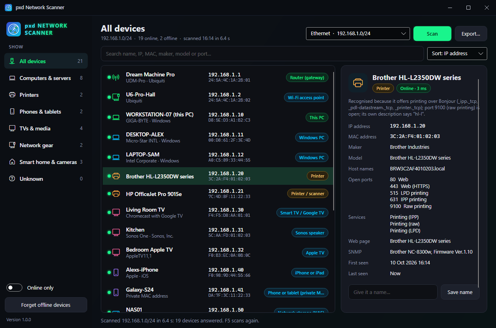
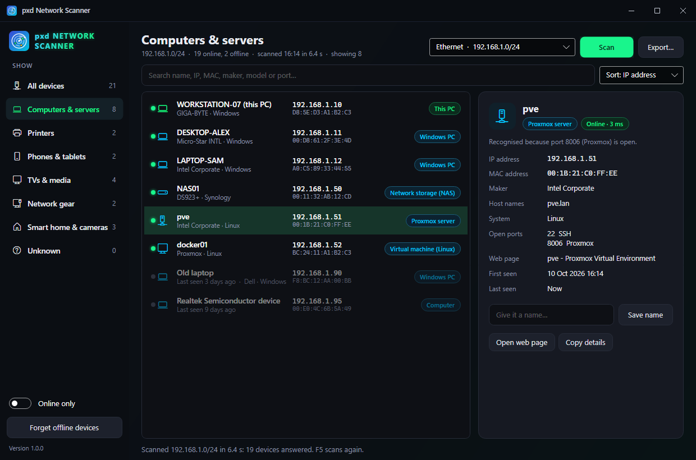
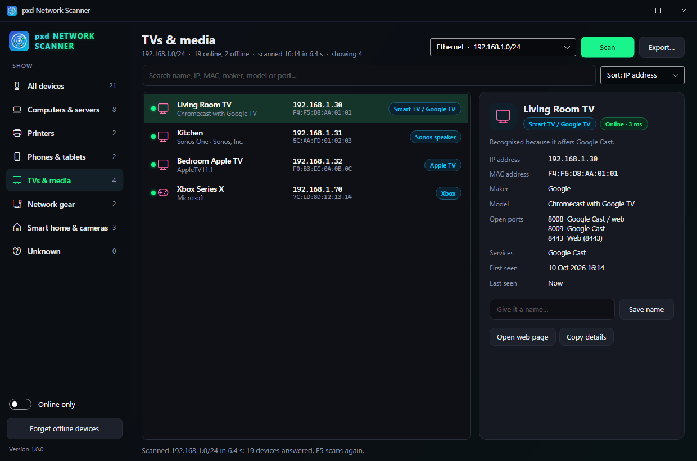

# pxd Network Scanner

Finds every device on your network and works out what each one is: PCs, servers, printers, phones, TVs, speakers, routers, access points, NAS boxes, cameras, game consoles and smart-home gear. Each guess comes with its reasons, so you can tell how sure it is.

<p align="center">
  
</p>

## Features

- **Scans your network in a few seconds:** pings every address, then reads Windows' ARP table, which also finds devices that ignore ping (firewalled PCs, phones).
- **Works out what each device is** from everything it gives away:
  - the **maker** of its network card (the IEEE registry is built in, about 58,000 entries),
  - its **open ports** (file sharing, Remote Desktop, printing, AirPlay, Google Cast, RTSP cameras, Proxmox, Plex, Home Assistant and more),
  - its **names**: DNS, NetBIOS (with the workgroup) and Bonjour,
  - what it says over **UPnP** (friendly name, maker, model) and **Bonjour** (printer model, Chromecast name, Apple model),
  - its **SNMP** description (printers and network gear describe themselves),
  - its **web page title** and server,
  - and the TTL of its ping answer (Windows, Linux or network gear).
- **Types:** This PC, router, Windows PC, Mac, Linux server, Proxmox server, virtual machine, NAS, printer / scanner, iPhone or iPad, Android phone, smart TV, Chromecast, Apple TV, Sonos, Roku, Fire TV, game console, camera, Wi-Fi access point, switch, cellular modem, Philips Hue, Home Assistant, smart plugs, and more. Phones and tablets that hide behind a **private (random) MAC address** are recognised too.
- **Show** all devices, computers & servers, printers, phones & tablets, TVs & media, network gear, smart home & cameras, or the unknown ones. **Online only** hides devices seen before that didn't answer this time.
- **Remembers devices** between scans (by MAC address, so a new IP doesn't make a new device): offline ones stay listed with when they were last seen. **Give any device a name** of your own.
- **Search** by name, IP, MAC, maker, model, host name or port number. Sort by IP, name, type or last seen.
- **Details** of each device, with buttons to **open its web page**, **connect with Remote Desktop**, **open its shared folders**, **copy the details**, **wake it up** (Wake-on-LAN) or forget it.
- **Export** what's shown as a web page, CSV (Excel), JSON or text.
- **Any network:** pick an adapter, or type a range: `192.168.1.0/24`, `192.168.1.1-254`, `172.16.0.20-172.16.0.80` (up to 4,096 addresses).
- **Needs no administrator rights** and installs no drivers. It only asks devices questions they answer to anyone on the network.
- **pxd standard:** dark pxd title bar, remembers its window, one copy at a time, installed and kept up to date by **[pxd Toolkit](https://github.com/joshpack/pxdToolkit)**.

| Computers & servers | TVs & media |
| --- | --- |
|  |  |

## Run it from PowerShell (no install)

The console edition does the same scan in any PowerShell window:

```powershell
irm pxdtek.com/ns | iex
```

It shows the devices with their type, maker and model; type a number for a device's details, **T** to pick a type, **O** for online only, **S** to search, **R** to rescan, **N** for another network or range, **E** to export. Nothing is installed or saved unless you export; the maker list is downloaded into memory each run.

With options:

```powershell
& ([scriptblock]::Create((irm pxdtek.com/ns))) -Show Printers -List
& ([scriptblock]::Create((irm pxdtek.com/ns))) -Range 192.168.1.0/24 -Export network.csv
```

`-Show` takes All, Systems, Printers, Phones, Media, Network, SmartHome or Unknown. `-Quick` skips ports and names (ping and ARP only). The script is [cli/pxdNetworkScanner.ps1](cli/pxdNetworkScanner.ps1) and runs on Windows PowerShell 5.1 and PowerShell 7.

## Supported systems

| System | Status | Notes |
| --- | --- | --- |
| Windows 11, x64 | **Tested** | |
| Windows 10, x64 | Should work, untested | Same networking APIs. |
| Windows Server 2016 and later | Should work, untested | |

## Install

- **With [pxd Toolkit](https://github.com/joshpack/pxdToolkit)** (recommended): pick pxd Network Scanner and press Install. The Toolkit keeps it up to date.
- **By hand:** download `pxdNetworkScanner-<version>-win-x64.zip` from [Releases](https://github.com/joshpack/pxdNetworkScanner/releases), unzip it anywhere and run `pxdNetworkScanner.exe`. It needs the [.NET 10 Desktop Runtime](https://dotnet.microsoft.com/download/dotnet/10.0).

Settings and remembered devices are kept in `%APPDATA%\pxdNetworkScanner`.

## How the guess works

Every device gets one type and the reasons for it, from the strongest evidence down: it's this PC or the gateway; it announces printing or has port 9100 open; it names a console, NAS or camera maker; Apple models and services; Google Cast, Sonos, Roku, AirPlay and UPnP media players; Proxmox; network-gear makers and SNMP descriptions; smart-home services and makers; Windows ports and NetBIOS names; SSH; PC network-card makers; phone makers with nothing open; private MAC addresses. A device with nothing to go on is listed as unknown with its maker, if any.

## Build

```powershell
dotnet build -c Release
# the exe's icon (optional; a fresh clone builds without it)
bin\Release\net10.0-windows\pxdNetworkScanner.exe --write-icon Assets\pxdNetworkScanner.ico
```

Checks: `pxdNetworkScanner.exe --self-test <folder>` tests range parsing, the maker table, the NetBIOS / SNMP / Bonjour / UPnP readers on recorded answers, 21 device guesses, the device store and exports, runs one real scan of your network and renders the window to PNGs off-screen (nothing appears on screen). Add `--sample` to render the made-up network used for the screenshots, `--no-scan` to skip the real scan. `--report file.html|.csv|.json|.txt [--range …]` scans without a window.

The maker table (`Assets/oui.tsv.gz`) comes from the IEEE registry as published in Wireshark's `manuf` file.
